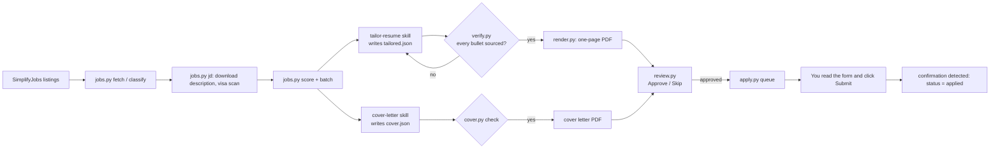
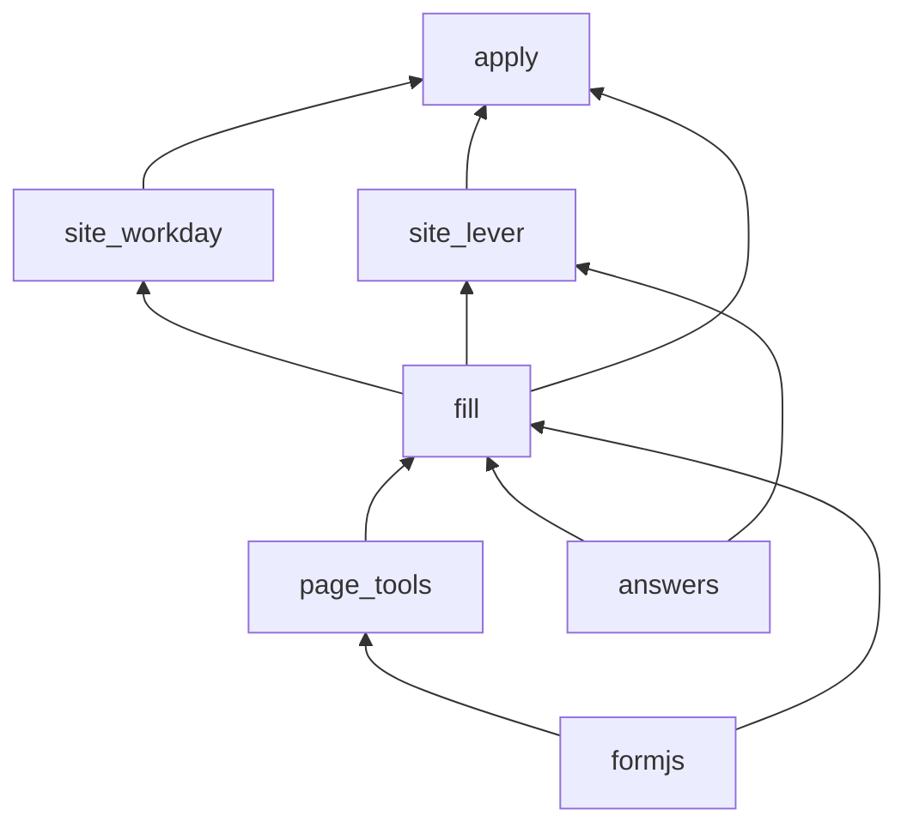

# Architecture

employMint is a pipeline of small Python scripts that share one SQLite file. The AI steps (reading a
posting, writing bullets, drafting answers) run as skills in your AI assistant; everything that *decides* something
is plain code with tests.

## Pipeline

## Components

| File | Role | Talks to |
|---|---|---|
| `src/jobs.py` | Listings, descriptions, visa flags, scoring, daily batch, statuses | SimplifyJobs, ATS public APIs, SQLite |
| `src/verify.py` | Checks a tailored resume against `profile/profile.json` | — |
| `src/render.py` | Resume JSON → one-page PDF (headless Chrome), measures page fill | Chrome |
| `src/cover.py` | Cover letter JSON → PDF + plain text, with the same fact check | Chrome |
| `src/review.py` | Local review page on 127.0.0.1; starts the apply queue | SQLite, apply.py |
| `src/apply.py` | Commands (`scan`, `open`, `queue`, `try`, `sheet`) and the queue loop | everything below |
| `src/answers.py` | What to answer: saved rules, per-job drafts, option picking (no browser) | `profile/answers.json` |
| `src/fill.py` | Fills one form question by question | Playwright |
| `src/formjs.py` | JavaScript run inside the page: read the form, mark fields, show the panel | — |
| `src/page_tools.py` | Waiting, panel, confirmation detection, launching Chrome | Playwright |
| `src/site_workday.py` | Workday's multi-step wizard and My Experience entries | Playwright |
| `src/site_lever.py` | Lever hand-off to your own Chrome + answer sheet | Chrome |
| `src/evals.py` | Quality report: answer accuracy, form coverage, grounding, page fill | all of the above |
| `src/me.py` | Who the applicant is: every personal setting, read from `profile/` | `profile/` |
| `src/profile_check.py` | Checks the profile files before anything uses them | `profile/` |
| `src/outreach.py`, `src/linkedin.py` | Optional recruiter outreach after applying (off by default; you approve each message) | LinkedIn |

Module dependencies only point one way, so any piece can be tested on its own:

## How a form gets answered

1. `formjs.EXTRACT_JS` walks the page and returns each question as
   `{title, kind, options, required, value}`. It tags each control with `data-em-c` so Python can find it again.
2. `answers.resolve` looks for an answer, in order:
   1. the job's own drafts (`resumes/<slug>/answers.json`), for essays and company-specific questions;
   2. the saved rules in `profile/answers.json`: a regex on the question, preferred option patterns, a text
      template, or a **flag** that means "you must answer this yourself" (consent, salary, high school).
3. `answers.pick_option` matches preferred patterns against the real options, best first. Text fallbacks
   only match whole words, so "No" never matches "Prefer not to say".
4. `fill.fill_question` fills the control and reports a state: filled, drafted (read it), check, or **you**.
   Fields the site already filled from the resume are kept.
5. The panel lists everything marked *you*, and the Submit button gets a dashed outline. The code never clicks it.

## Safety properties

- **No fabrication:** `verify.py` and `cover.py` compare numbers and tech terms in each bullet or paragraph
  against the cited facts. Unknown skills, courses not taken, and uncertified certifications are errors.
- **Human submits:** there is no submit call anywhere. `page_tools.submitted` only *detects* the confirmation page.
- **One browser per profile:** `launch_browser` takes a file lock, so the queue and a single "Open application"
  can't fight over the same Chrome profile.
- **Local only:** the review server binds to 127.0.0.1 and rejects requests whose `Host` or `Origin` isn't
  local (blocks DNS rebinding). POSTs also need a custom header, which cross-site pages can't send.
- **Panel buttons:** only the top frame can call `employmintAction`, so an ad iframe on a job site can't
  mark a job as applied.
- **No bot evasion:** Lever and SmartRecruiters are handed to your own browser instead.

## Data

| Path | Contents | In git? |
|---|---|---|
| `profile/profile.json` | The only source of resume facts | never (ignored) |
| `profile/answers.json` | Form-answer rules and values | never (ignored) |
| `profile/preferences.json` | Season, role tracks, sponsorship, optional features | never (ignored) |
| `profile/guidance.md` | Your own rules for the AI skills (optional) | never (ignored) |
| `resumes/<slug>/` | Job description, tailored.json, PDFs, answers.json | never (ignored) |
| `examples/profile/` | Made-up sample applicant; the shared tests run against it | yes |
| `data/jobs.sqlite` | Listings, scores, statuses | never |
| `data/browser-profile/`, `data/linkedin-profile/` | Chrome profiles with login cookies | never |
| `evals/` | Your hand-checked answers, report, history | never (ignored) |
